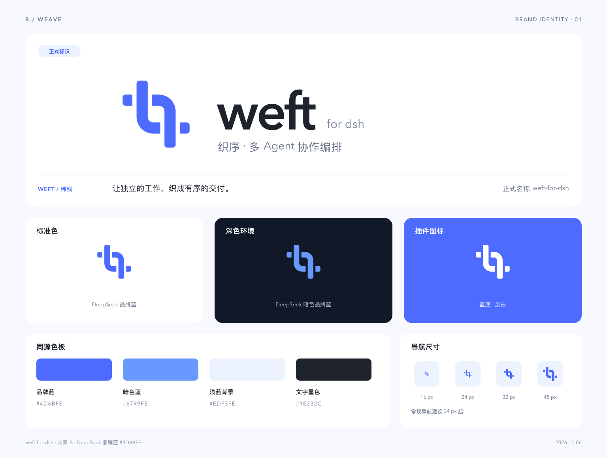

# weft-for-dsh · 正式品牌素材

**weft-for-dsh** 的正式品牌素材，中文品牌为 **织序**。交织 Logo 表达独立 Agent 之间的协作、交接与有序交付。

正式名称在文档、仓库名与包名中统一使用 `weft-for-dsh`；视觉字标排作 `weft for dsh`。

## 文件

| 用途 | SVG | PNG |
| --- | --- | --- |
| 标准蓝色 Logo | [mark-brand.svg](svg/mark-brand.svg) | [512 px](png/mark-brand.png) |
| 深色背景 Logo | [mark-dark.svg](svg/mark-dark.svg) | [512 px](png/mark-dark.png) |
| 单色 Logo | [mark-ink.svg](svg/mark-ink.svg) | [512 px](png/mark-ink.png) |
| 反白 Logo | [mark-white.svg](svg/mark-white.svg) | [512 px](png/mark-white.png) |
| 浅底字标组合 | [wordmark-light.svg](svg/wordmark-light.svg) | [912 px](png/wordmark-light.png) |
| 深底字标组合 | [wordmark-dark.svg](svg/wordmark-dark.svg) | [912 px](png/wordmark-dark.png) |
| 完整名称组合 | [name-lockup.svg](svg/name-lockup.svg) | [960 px](png/name-lockup.png) |
| 蓝底插件图标 | [app-icon.svg](svg/app-icon.svg) | [512 px](png/app-icon.png) |
| 深色插件图标 | [app-icon-dark.svg](svg/app-icon-dark.svg) | [512 px](png/app-icon-dark.png) |

透明 Logo PNG 尺寸：[16](png/mark-16.png)、[24](png/mark-24.png)、[32](png/mark-32.png)、[64](png/mark-64.png)、[128](png/mark-128.png)、[256](png/mark-256.png)、[512](png/mark-512.png)、[1024](png/mark-1024.png) px。常规导航建议 24 px 起。

表中的正式字标 SVG 已转为纯矢量路径，跨设备使用无需安装字体。另保留可编辑文字源：[浅底](svg/wordmark-light-editable.svg)、[深底](svg/wordmark-dark-editable.svg)、[完整名称](svg/name-lockup-editable.svg)。文字源使用 Avenir Next，便于后续编辑。

## 配色

| 用途 | 色值 |
| --- | --- |
| 主色 | `#4D6BFE` |
| 深色背景强调色 | `#6799FE` |
| 浅蓝衬底 | `#EDF3FE` |
| 深色文字 | `#1E232C` |

保留 SVG 的比例和留白。深色背景使用暗色蓝或反白图形；纯图形与字标可按场景独立使用。

[品牌规范与来源](../../docs/brand/README.md)。
