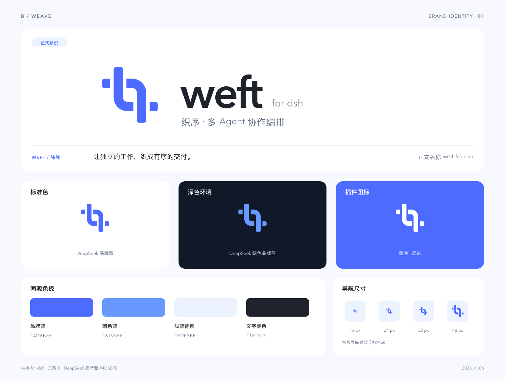

# weft-for-dsh · 品牌规范

- 正式名称：**weft-for-dsh**，统一使用小写及连字符。
- 展示字标：**weft for dsh**；中文品牌：**织序**。
- Logo：两条开放折带交织，表达独立 Agent 之间的协作、交接与有序交付。
- 主色：**`#4D6BFE`**；暗色环境使用 **`#6799FE`**。
- 功能说明：**多 Agent 协作编排**。

正式素材统一存放在 [assets/brand](../../assets/brand/README.md)。产品界面、项目文档和后续发布应引用该目录。

Weft 为纬线，寓意把独立 Agent 的工作编织成有序交付。

## 素材使用

纯图形、字标组合和插件图标均提供 SVG 与 PNG，文件索引见 [正式素材说明](../../assets/brand/README.md)。正式字标 SVG 已转为矢量路径；另提供使用 Avenir Next 的可编辑文字源。

保留图形比例与留白。深色背景使用暗色蓝或反白版本；纯图形与字标可按场景独立使用。常规导航建议使用 24 px 及以上尺寸。

## 配色与来源

| 用途 | 色值 | 参考设计变量 |
| --- | --- | --- |
| 标准 Logo | `#4D6BFE` | `--ds-color-brand`（默认主题） |
| 深色背景强调色 | `#6799FE` | `--ds-color-brand`（深色主题） |
| 浅蓝衬底 | `#EDF3FE` | `--dsw-static-deepseek-50` |
| 深色文字 | `#1E232C` | `--ds-color-text-primary`（默认主题） |

配色参考 [DeepSeek 官网](https://www.deepseek.com) 的公开 [CSS 设计变量](https://www.deepseek.com/_next/static/css/ddd6172044536759.css)。品牌板的夜色背景使用 `#111827`。
